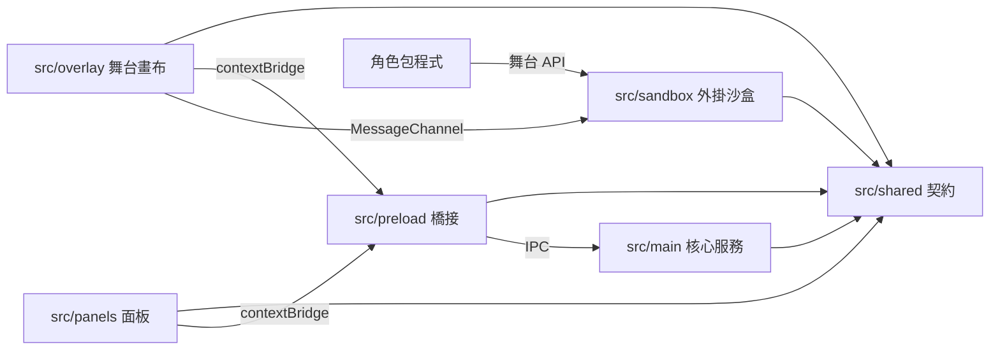
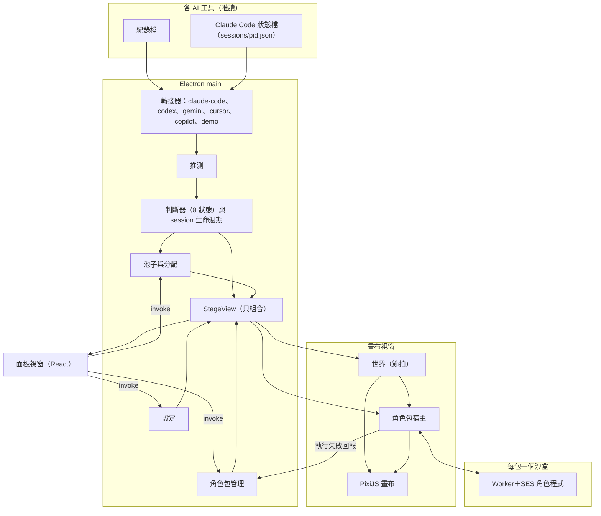

# Architecture Spine — AI Watchdog Pet 舞台

## Design Paradigm

**微核心（外掛）架構。** 舞台是核心，沒有任何角色包也能完整運作；角色包是外掛，只能在舞台上演出，不能獨立運作。舞台程式裡不出現任何角色的名字或專屬邏輯。Demo 分支只當行為參考：功能以 Demo 為基準，不移植 Swift 程式或腳本格式。

| 層 | 執行位置 | 目錄 | 負責 |
| --- | --- | --- | --- |
| 契約 | 各處共用 | `src/shared/` | 型別與 zod schema：狀態碼、偵測事件、IPC 訊息、角色包 API（`pack-api/`）、manifest、參數宣告、設定檔、運行常數 |
| 核心服務 | Electron main（Node） | `src/main/` | 偵測、session 與池子分配、設定存取、StageView 組合、角色包安裝／匯入／匯出、視窗與協定、運行紀錄 |
| 橋接 | 每個 renderer 一支 preload | `src/preload/` | `overlay.ts`、`panels.ts`，各自只暴露最小 IPC API |
| 舞台畫布 | overlay renderer | `src/overlay/` | 世界（位置、移動、碰撞、物件、節拍）、PixiJS 繪圖、角色包宿主、滑鼠命中 |
| 面板 | panel renderer（React） | `src/panels/` | 角色編輯頁、管理 session、角色包管理、舞台設定、展示／示範控制 |
| 外掛沙盒 | sandbox iframe → Worker | `src/sandbox/` | 載入一包角色程式，只透過舞台 API 溝通 |

## Invariants & Rules



### AD-1 — 舞台獨立運作，角色只以外掛存在 [ADOPTED]

- **Binds:** all
- **Prevents:** 舞台裡長出角色專屬程式；沒有角色包時舞台壞掉
- **Rule:** `src/` 不得出現任何角色、系列名稱或角色專屬分支。沒有安裝任何角色包時，偵測、面板、管理 session 都照常運作，畫布為空。

### AD-2 — 依賴方向與行程邊界

- **Binds:** `src/shared`、`src/main`、`src/preload`、`src/overlay`、`src/panels`、`src/sandbox`
- **Prevents:** renderer 直接讀檔或碰 Node；面板與畫布各自存一份狀態
- **Rule:** 依賴只能照上圖方向。`shared` 不依賴任何層。`overlay`、`panels` 只能透過各自 preload 暴露的 API 呼叫 `main`，不得 import `src/main`。preload 只依賴 `shared` 與 Electron 的 renderer API。角色包程式只看得到舞台 API，不得 import 舞台任何原始碼。CI 以 dependency-cruiser 強制（AD-25）。

### AD-3 — 資料唯一擁有者

- **Binds:** all
- **Prevents:** 同一份資料兩個地方改，彼此不同步；兩個模組寫同一個檔
- **Rule:**

| 資料 | 唯一擁有者 | 其他人 |
| --- | --- | --- |
| session 清單、8 狀態、顯示名稱（觀察到的事實） | `main/detection` | 經 StageView 訂閱 |
| session → 角色分配（`actorId`）、池子、session 顯示／釋放 | `main/pool` | 經 StageView 訂閱；寫入走 `pool:*` |
| 舞台設定（覆蓋值、池子勾選、固定參數、計時秒數） | `main/settings` | 經 StageView 訂閱；寫入走 `settings:patch`（AD-23） |
| 已安裝角色包、執行失敗標記 | `main/packs` | 唯讀 |
| StageView | `main/stage-view`（只組合，不擁有資料） | 訂閱（AD-20） |
| 世界（位置、移動、碰撞框、飛行物件、節拍） | `overlay/world` | 角色包只收事件 |
| 角色自己的演出狀態 | 該角色包（以 `actorId` 為 key） | 舞台看不到內部 |

只有 `main` 寫檔，一個檔一個擁有者。每個持久檔帶 `schemaVersion`，由 `main/<擁有者>/migrations` 只往前遷移；遷移失敗才走壞檔流程。

| userData 內 | 擁有者 |
| --- | --- |
| `settings.json` | `main/settings` |
| `assignments.json`（含顯示／釋放） | `main/pool` |
| `packs/`（`index.json`＋`<packId>/<version>/`） | `main/packs` |
| `logs/` | `main/log` |

### AD-4 — 偵測完全唯讀 [ADOPTED]

- **Binds:** `main/detection`
- **Prevents:** 動到使用者各 AI 工具的設定與防護 hook；讀到 AI 工具的憑證或連入其訊息通道
- **Rule:** 舞台永遠不寫入任何 AI 工具的檔案或設定（不裝 hook、不改 settings）。來源只有下表的唯讀來源。Claude Code 的即時狀態 [ADOPTED] 直接讀 `~/.claude/sessions/<pid>.json`：只讀檔名符合 `^\d+\.json$` 的檔，只取 `pid`、`sessionId`、`status`、`waitingFor`、`name`、`cwd`、`statusUpdatedAt`；禁止讀 `*.key`，禁止連 `messagingSocketPath` 或任何 socket；不執行任何 `claude` 指令（2026-11-03 實測 `claude agents --json` 每次執行會寫入 `~/.claude/` 的鎖檔與快取）。這個格式沒有公開，解析失敗或必要欄位缺少時，該轉接器標 `degraded`，Claude Code 退回只讀 transcript＋推測。

| 來源代碼 | 唯讀來源 | 已知抓不到（交給推測，AD-22） |
| --- | --- | --- |
| `claude-code` | 狀態檔 `~/.claude/sessions/<pid>.json`＋transcript `~/.claude/projects/<cwd>/<id>.jsonl` | 狀態檔那一半（Story 2.4 後半）完成前：批准、提問都用推測，`/clear` 後舊 session 照逾時結束，沒有行程結束的訊號。完成後：無；狀態檔格式變動時，批准改用推測（2026-11-13 Epic 2 回顧對齊） |
| `codex` | rollout `~/.codex/sessions/YYYY/MM/DD/*.jsonl`＋顯示名稱 `~/.codex/session_index.jsonl` | 批准、提問、錯誤 |
| `gemini` | `~/.gemini/tmp/<專案>/chats/session-*.jsonl` | 批准、提問（`ask_user` 要等使用者回答後才寫入）、一輪結束（不寫，改推測，見 AD-22）；工具呼叫要整批完成後才寫入（Story 2.6） |
| `cursor` | `~/.cursor/projects/<slug>/agent-transcripts/<id>/<id>.jsonl`（IDE 與 cursor-agent CLI 同格式）；顯示名稱由 slug 推出候選專案路徑，只檢查路徑是否存在（stat），不讀其內容 | 批准（沒有 tool_result 與權限紀錄，只能推測）、提問（`AskQuestion` 的回答不寫入，Story 2.7）；以 step 為單位寫入，延遲數秒到數十秒，2 秒目標不適用 [ADOPTED]；`turn_ended` 的 error 多數是使用者中止，要看錯誤字串；檔案可能整檔重寫 |
| `copilot` | Copilot CLI `~/.copilot/session-state/<id>/events.jsonl`＋顯示名稱 `workspace.yaml`；根目錄可由 `COPILOT_HOME` 改變（第一版只做 CLI；VS Code 版延後） | 等你回覆、提問（`session.idle`、`user_input.requested` 不寫檔，要推測）；本機沒有樣本，排在最後做，用真實 session 驗證過才算完成 [ADOPTED] |

### AD-5 — 轉接器只翻譯，判斷器決定狀態 [ADOPTED]

- **Binds:** `main/detection/adapters/*`、`main/detection/reducer`
- **Prevents:** 狀態判斷散在各轉接器；新增 AI 工具要改判斷邏輯
- **Rule:** 每個 AI 工具一個轉接器，只輸出 `shared` 定義的共用事件：`session.start|end|meta`、`turn.start|end`、`turn.reply`、`tool.start|end`、`approval.request|resolved`、`question.request|resolved`、`error`、`activity`。`turn.reply` 只給不會寫「一輪結束」的來源，表示一個可能結束這一輪的回覆（Story 2.6）。每個事件帶 `source`、`sessionKey`、`ts`、`via`（log／registry／inferred）、`confidence`（exact／inferred）。8 狀態只由判斷器決定，優先序：`approval` > `decision` > `error` > `working` > `thinking` > `done` > `waiting` > `idle`。紀錄檔抓不到的批准、提問用推測產生（工具開始後超過門檻秒數沒結束），標 `inferred`。事件欄位、條件表與推測位置的細則見 AD-21、AD-22。

### AD-6 — 舞台定義固定 8 狀態 [ADOPTED]

- **Binds:** 偵測、角色包 API、面板
- **Prevents:** 角色包綁某個 AI 工具的訊號
- **Rule:** 狀態碼固定為 `waiting`、`thinking`、`working`、`approval`、`decision`、`done`、`idle`、`error`。角色包只收到這 8 種。`done` 是過場：一輪結束先 `done` 指定秒數再轉 `waiting`；一段時間沒事件轉 `idle`；秒數都是舞台設定。角色包沒實作的狀態，舞台改演該包宣告的後備演出，沒宣告就演舞台內建的佔位演出（宣告方式見 AD-18）。

### AD-7 — 角色包是沙盒裡的程式外掛 [ADOPTED]

- **Binds:** `src/sandbox`、`overlay/pack-host`、`main/windows`
- **Prevents:** 匯入的包讀檔、連網、執行指令、讀取對話內容或其他包
- **Rule:** 演出邏輯由角色包自己寫，但只能在以下沙盒執行，任何一層都不得省略：
  1. 每包一個 `<iframe sandbox="allow-scripts">`，不給 `allow-same-origin`，文件由 `pack://_stage/sandbox.html` 提供，CSP `default-src 'none'; script-src 'sha256-<bootstrap 雜湊>' 'unsafe-eval'; worker-src blob:; connect-src 'none'`。雜湊於建置時產生，CSP 字串只由 `src/sandbox` 一個模組產生。`'unsafe-eval'` 只為 SES 而開、只出現在沙盒 iframe 與其 Worker；隔離靠 Worker＋Compartment＋封網，不靠禁 eval。
  2. 包程式只在 iframe 內的 **classic Worker** 執行，絕不在 window context 執行。
  3. Worker bootstrap 先移除 fetch、XHR、WebSocket、EventSource、WebTransport、importScripts、巢狀 Worker、indexedDB、caches（沿原型鏈刪除，這些多半在 `WorkerGlobalScope.prototype` 上），再逐條移除「SES 尚未認得的 intrinsics」清單 [ADOPTED]（清單只在 `src/sandbox` 一處逐條列名，架構與 epics 只引用、不列內容；目前內容與來由見 Story 1.2 原型報告），再以**不帶任何選項**的 SES `lockdown()` 鎖定（不得有任何警告；要改 lockdown 選項或升級 Electron、SES，都必須跑完 AD-25 全部測試，出現新警告就更新清單並請使用者確認），包放進 `Compartment`，只注入舞台 API（AD-16）。Compartment 內沒有 `Date.now`／`new Date()`／`Math.random`（SES 預設）、`console`、計時器、`Float32Array`／`Float64Array`，第一版不另注入。
  4. Electron 層的設定見 AD-24。
  5. 舞台與包之間只用 MessageChannel（port 直接交給 Worker，iframe 不轉發），每則訊息用 `shared` 的 schema 驗證、限速；心跳逾時、超限或未捕捉例外時，由 `overlay/pack-host` 移除該包 iframe（連帶終止 Worker），該包角色改演佔位演出，舞台不受影響（AD-19）。

  包可以取得：自己包內的素材、自己角色的有效參數、舞台給的相對時鐘、舞台事件、session 顯示名稱。其餘一律沒有（含聲音、滑鼠事件、牆上時間 API）。

  **原型閘門：** 以下全部在 Electron 45.2.1 實測通過前，不開始 `src/sandbox`、`overlay/pack-host` 與角色包 API 的實作；任一項失敗就回頭修訂本條並請使用者確認：(a) sandbox iframe 內能以 blob 建 classic Worker；(b) Worker 內 `lockdown()` 無錯誤、無警告，`Compartment.evaluate` 可執行；(c) Worker 內 fetch、XHR、WebSocket、EventSource 全被擋；(d) overlay 能以 PixiJS 從 `pack://` 載入貼圖，並確定 `pack` scheme 需要的最小權限（AD-24）。

### AD-8 — 角色包 API 有版本 [ADOPTED]

- **Binds:** manifest、`main/packs`、`overlay/pack-host`
- **Prevents:** 舊包在表演中途才壞
- **Rule:** manifest 必填 `apiVersion`，格式 `"<major>.<minor>"`（字串，schema 驗證）。舞台只接受主版號相同、且包的 minor ≤ 舞台 minor 的包；安裝與載入時檢查，不相容就拒絕並寫明「需要舞台 API ≥ x.y」。新增訊息、指令、欄位升 minor；移除或改變語意升 major。舞台支援的版本常數只定義在 `src/shared/pack-api`。舞台只送該包宣告的 minor 以內存在的訊息與欄位；包必須忽略不認得的欄位與訊息。

### AD-9 — 包給繪圖指令，舞台統一畫 [ADOPTED]

- **Binds:** `overlay/renderer`、角色包 API
- **Prevents:** 每個角色一個 WebGL context 撞到上限；命中與畫面不一致
- **Rule:** 角色包每格回傳繪圖指令（圖片、格、位置、變形、粒子參數），舞台用**單一** PixiJS WebGL 畫布畫全部角色；`src/overlay` 不引入 React。進階模式可在 Worker 用舞台提供的 OffscreenCanvas 畫成 ImageBitmap 交給舞台當貼圖，尺寸與 fps 由舞台限制；只允許 `2d` context，不得開 WebGL／WebGPU，且須在 manifest 宣告。滑鼠命中判定由舞台做。指令格式、座標與素材見 AD-17。名牌與狀態標記 [ADOPTED] 由舞台統一畫在角色上方，位置用 manifest 每個角色的 `anchor`；名牌顯示 session 顯示名稱；`confidence` 為 `inferred` 的狀態用另一種樣式的標記；固定參數「名牌與標記顯示」關閉時兩者都不畫。包不畫名牌，顯示名稱只供演出使用。

### AD-10 — 世界歸舞台，跨包只透過通用事件 [ADOPTED]

- **Binds:** `overlay/world`、角色包 API
- **Prevents:** 各包命中算法不一致；包讀取別包狀態
- **Rule:** 角色位置、移動、遊走、碰撞框、飛行物件都是 `overlay/world` 的。包要發射就呼叫舞台 API：包有自訂物件就用包的素材；沒指定、或指定了舞台不認得且包裡也沒附（含素材載入失敗）時，舞台都改丟一個隨機的通用物件，不報錯、不會什麼都不丟。命中由舞台判定。第一版通用事件五種：被擊中（`hit`）、靠近／碰撞（`proximity`）、角色進場／離場（`enter`／`leave`）、狀態廣播（`state-broadcast`）、被使用者捏起來（`grab`）。目標包沒處理該事件就不反應；被捏起來的角色沒實作捏起來動作，就照原樣被拎著走。同一包的角色在同一個沙盒裡；包內特殊互動的反應邏輯由包自己寫，觸發仍來自舞台事件，涉及世界物件（發射、命中）一律走舞台 API。包只能請自己的角色停在原地／恢復遊走、轉向（`stage.hold`、`stage.face`，AD-16），不能指定位置、看不到座標；使用者的遊走偏好優先，設成不遊走就一定不動 [ADOPTED]。事件與發射細則見 AD-18。

### AD-11 — 參數兩層、覆蓋值歸舞台 [ADOPTED]

- **Binds:** `main/settings`、`panels/editor`、角色包 manifest
- **Prevents:** 重新匯入角色包蓋掉使用者調整；每個角色手寫設定畫面
- **Rule:** 編輯頁上半部是舞台定義的固定參數：大小、加入池子、遊走偏好、名牌與標記顯示。下半部依 manifest 的參數宣告自動產生，型別限 `bool`、`int`、`number`（`min`／`max`／`step`）、`choice`、`asset`（換圖，只能從 manifest `assets` 已宣告的 key 挑）。有效值＝舞台覆蓋值 ?? 包的預設值，以角色為單位（key `<packId>/<characterId>`），同一角色不論在哪個 session 都一樣。覆蓋值只存在舞台設定，不寫進角色包；包更新後已不存在的參數，覆蓋值保留但不套用。有效值的計算與寫入流程見 AD-23。
  - **固定參數的格式 [ADOPTED]：** 大小 `scale`＝0.5～2.0、每格 0.1、預設 1.0（100%＝角色包的原始大小，hitbox 等比例縮放）；加入池子 `inPool`＝bool、預設開；名牌與標記顯示 `badges`＝bool、預設開；遊走偏好 `wander`＝`enabled`（bool，預設開）、`areas`（九宮格格號 0～8 可多選，預設下排 `[6, 7, 8]`，是軟偏好不是限制）、`activity`（`low`／`medium`／`high`，預設 `medium`，決定停留多久才走）、`speed`（`slow`／`medium`／`fast`，預設 `medium`）。
  - **固定參數的預設來源 [ADOPTED]：** 舞台覆蓋值 ?? manifest 該角色的 `defaults`（只能給 `scale`、`wander`）?? 舞台預設，與包參數同一套規則。
  - **推薦原始大小 [ADOPTED]：** 角色身高（腳底到頭頂）推薦 110 基準像素（1 基準像素＝大小 100% 時的 1 個螢幕點；以 Demo 力天使為準）。manifest 每個角色必填實際 `height`；偏離推薦值 ±25%（約 83～138）時，角色包管理頁顯示提示，不擋匯入，也不自動換算。

### AD-12 — 池子與分配 [ADOPTED]

- **Binds:** `main/pool`、`main/detection`
- **Prevents:** 池子還沒用完時同一角色重複出現；分配在畫布與面板間不一致
- **Rule:** 池子＝使用者勾選上場的包 ∩ 固定參數「加入池子」為開的角色。「加入池子」每個角色只有一個，是舞台設定（不寫進角色包）；編輯頁與包管理頁的勾選框是同一個值。一個 session 一隻；池子用完前畫面上不重複，用完才重複；session 結束角色放回。使用者可指定哪些 session 顯示、哪些釋放不追蹤（釋放＝收回角色、不再分配；已釋放的 session 照常偵測狀態、仍留在管理清單，可改回顯示）。分配結果與顯示／釋放由 `main/pool` 持久化，回收依 AD-22。

### AD-13 — 角色包檔案 `.awpet`

- **Binds:** `main/packs`、manifest schema
- **Prevents:** 惡意壓縮檔寫出資料夾；安裝失敗留下半套；同 packId 的包靜默互相覆蓋；畫布被超大圖片吃光記憶體
- **Rule:** `.awpet` 是 zip，根目錄一個 `<packId>/`，內含 `manifest.json`、程式與素材。manifest 必填 `id`、`name`、`version`（semver）、`apiVersion`、`entry`、`assets`（key → 單張圖或 PixiJS spritesheet JSON）、`characters`；選填 `projectiles`（key → `assets` 的 key）。每個角色宣告 `id`、`name`、`height`（身高，基準像素，見 AD-11）、參數宣告、`states`（已實作的狀態碼）、選填 `fallback`、`hitbox`、`bounds`、`anchor`（名牌與標記的位置，本地座標）、選填 `defaults`（固定參數 `scale`、`wander` 的建議預設）、選填 `advancedBitmap`。`packId`、`characterId` 符合 `^[a-z0-9][a-z0-9-]{1,63}$`；`characterId` 是跨版本的穩定身分。匯入時擋 `..`、絕對路徑、捷徑檔，限制解壓總大小、檔案數、每張圖寬高與總像素（上限為 shared 常數），manifest 用 schema 驗證、入口試解析；安裝先解到暫存，成功才替換，失敗回復舊版。匯入的 packId 已存在時，顯示新舊名稱與版本請使用者確認才替換，降版另外警告。匯出只包含角色包本身，不附帶使用者的覆蓋值 [ADOPTED]。

### AD-14 — 透明置頂穿透畫布 [ADOPTED]

- **Binds:** `main/windows`、`overlay`
- **Prevents:** 畫布擋住使用者操作；各平台行為分歧
- **Rule:** 畫布視窗透明、無邊框、置頂，預設滑鼠穿透並用 `setIgnoreMouseEvents(true, { forward: true })` 持續收游標位置；`overlay` 判斷游標在角色 hitbox 上才請 `main` 關閉穿透。穿透狀態由 overlay 擁有，只在「在角色上／不在」改變時送帶遞增 `seq` 的請求，main 冪等處理並丟棄過時請求。macOS 用 `type: 'panel'`（已在所有桌面空間可見，不另呼叫 `setVisibleOnAllWorkspaces`）。Linux 降級為整窗穿透，選單改走系統匣。Windows 前景是管理員權限視窗時 forward 會暫停，接受為已知限制。第一版只開一個畫布視窗，放在使用者選的螢幕；世界座標＝該螢幕的 DIP、原點左上，`main/windows` 在邊界或縮放比例改變時通知 overlay。
  - **捏起來拖走 [ADOPTED]：** 左鍵按在角色 hitbox 上並拖曳，`overlay/world` 把該 actor 標為被捏起來：暫停遊走、跟著游標移動、位置限制在畫面內；放開時落在放開的位置，並從那裡直接恢復遊走。拖曳期間 overlay 維持不穿透，直到放開，即使游標移出 hitbox。包只收到 `grab` 事件（AD-18），收不到任何原始滑鼠事件。
  - **右鍵與入口 [ADOPTED]：** 右鍵角色開選單：這個角色的編輯頁、管理 session、暫停／顯示。app 入口放在 macOS 選單列與 Windows 系統匣；平常不顯示 Dock／工作列圖示，有任何面板視窗開著時才暫時顯示（可 ⌘Tab／Alt+Tab 切回），面板全部關掉就隱藏。app 已在執行時再次啟動（應用程式資料夾、Spotlight、開始選單），不開第二個實例，改打開主面板（AD-26）。選單內容由 `main/windows` 一處定義，角色包不能加項目。

### AD-15 — 展示與示範走同一條管線 [ADOPTED]

- **Binds:** `main/detection/adapters/demo`
- **Prevents:** 展示模式另寫一套繞過偵測的邏輯，跟真實行為不同
- **Rule:** 展示、示範模式實作成一個假的 `demo` 轉接器，輸出同一套共用事件，經同一個判斷器、池子與世界。示範模式照池子分配。展示模式可指定任何角色（含未加入池子的），指定只對 `demo` 來源的 session 有效、不存檔、不佔池子名額。編輯頁的「在畫面上預覽」就是展示模式在畫布上演。

### AD-16 — 角色包 API v1：程式格式、actor 與訊息

- **Binds:** `src/shared/pack-api`、`src/sandbox`、`overlay/pack-host`、`main/pool`、第三方角色包
- **Prevents:** 舞台與包作者各自發明協定；同一角色同時兩隻時無法定址；包在一般瀏覽器能跑、進舞台才壞
- **Rule:**
  - 契約（型別、zod schema、常數）只在 `src/shared/pack-api/`，除 zod 外不依賴任何東西。
  - 入口：manifest `entry` 指向單一、已自行打包、不含 `import`／`require` 的 classic script，求值結果為工廠函式 `(stage) => handlers`；`handlers` 的鍵是下表的訊息名稱，`frame` 的回傳值就是該 tick 的 `draw`。其他格式在安裝時拒絕。
  - 包程式所在的 Worker 不是 secure context（`isSecureContext` 為 false，沒有 `crypto.subtle`）；亂數只由 `stage.random` 提供（Story 1.2 原型實測）。
  - `stage` 是包唯一能用的 API：`stage.fire`（AD-18）、`stage.random(actorId)`（每個 actor 一個種子）、`stage.log`（限速，帶 `packId` 寫入運行紀錄）、`stage.canvas`（只限宣告 `advancedBitmap` 的角色，回傳 OffscreenCanvas 的 2d context）、`stage.hold(actorId, on)`（己方角色停在原地／恢復遊走）、`stage.face(actorId, 'left' | 'right')`（轉向）。`hold`／`face` 只對己方 actor 有效，使用者設為不遊走或角色被捏起來時不生效。時間只來自 `frame` 的 `t`。
  - 畫面上每一隻是一個 **actor**。`actorId` 由 `main/pool` 在建立分配時產生（不透明字串，app 執行期間不重用）；一筆分配＝一個 session × 一個角色＝一個 `actorId`，換角色＝舊 actor 結束、新 actor 產生。所有舞台↔包訊息、世界實體、繪圖、發射一律以 `actorId` 定址；同一角色可同時有多個 `actorId`，包的內部狀態以 `actorId` 為 key，`characterId` 只用來選外觀與參數。
  - `overlay/pack-host` 驗證包送出的每則訊息裡的 `actorId` 屬於該包，否則整則丟棄並記錄 `packId`。包看不到 `sessionKey`、`source`、`confidence`，也看不到別包的 `packId`、`characterId`。

  | 訊息（舞台→包） | 內容 | 時機 |
  | --- | --- | --- |
  | `init` | 現場所有 actor：`actorId`、是否己方、狀態；己方另含 `characterId` | 沙盒建立或重啟後第一則；不補發歷史 |
  | `spawn`／`despawn` | 己方 actor：`actorId`、`characterId`、完整有效參數、狀態、session 顯示名稱 | 己方 actor 加入／移出 |
  | `params` | 某己方角色的完整有效參數 | 參數變更，同一角色每 tick 至多一則 |
  | `meta` | 己方 actor 的 session 顯示名稱 | 顯示名稱變更 |
  | `frame` | `seq`、`t`（舞台相對毫秒）、`dt`、己方 actor 的狀態（已依 AD-18 對應）與 `motion`（是否移動、面向、是否被捏起來 `held`）、本 tick 的通用事件 | 每個邏輯 tick（AD-17） |

  包→舞台只有：`frame` 的回傳值（`draw`）、`stage.fire`、`stage.hold`、`stage.face`、`stage.log`。心跳 `ping`／`pong` 由 Worker bootstrap 在 Compartment 外處理。

### AD-17 — 角色包 API v1：節拍、繪圖指令與素材

- **Binds:** `overlay/world`、`overlay/renderer`、`overlay/pack-host`、`src/shared/pack-api`、第三方角色包
- **Prevents:** 一包變慢拖住全部角色；畫面、命中與縮放各算一套；包把角色畫到世界以為它不在的地方
- **Rule:**
  - 節拍唯一擁有者是 `overlay/world`，邏輯頻率 `tickHz`（shared 常數，預設 30）。每 tick 對有 actor 的包送一則 `frame`；每包同時最多一則在途，上一則沒回就跳過該包這一格，不排隊。renderer 每個顯示幀用該包最後一則有效 `draw`，永不等待。連續 `drawTimeoutMs` 沒有有效 `draw` 視同執行失敗（AD-19）。
  - 繪圖座標一律是 actor 本地座標：原點＝world 給的錨點（角色腳底中心），單位＝基準像素（未乘「大小」），y 向下。舞台在外層依序套 world 位置、固定參數「大小」、actor 之間的層級（world 依 y 排序）。指令內 `z` 只排同一 actor 內的前後；超出 manifest `bounds` 的內容裁切。
  - v1 指令是封閉清單：`sprite`（`asset`、`frame`、`x`、`y`、`rotation`、`scaleX`、`scaleY`、`alpha`、`z`）、`particles`（`emitterId`、`preset`、`x`、`y`、參數；同一 `emitterId` 跨 frame 持續，下一則 `draw` 沒出現就停止發射）、`bitmap`（只限 `advancedBitmap` 角色，ImageBitmap 以 transfer 傳送）。
  - 素材：`asset` 是 manifest `assets` 的 key，`frame` 是該 spritesheet 的格名稱（單張圖不填）。renderer 自行從 `pack://<packId>/<version>/<path>` 載入並依 URL 快取；除 `bitmap` 外，包不傳任何圖檔位元組。
  - 命中、碰撞、滑鼠穿透只用 manifest 每個角色的 `hitbox`（本地座標矩形）×「大小」，由 world 計算；繪圖內容不影響。
  - 限額（每則 `draw` 每個 actor 的指令數、單則位元組數、每包 emitter 數、`bitmap` 尺寸與每秒張數）是 shared 常數；超限整則丟棄並記錄 `packId`。

### AD-18 — 角色包 API v1：通用事件、發射與狀態對應

- **Binds:** `overlay/world`、`overlay/pack-host`、`overlay/renderer`、manifest、第三方角色包
- **Prevents:** 同一事件多處發出或語意不同；包靠事件辨認別包身分做專屬反應；後備演出的判定方式各自猜
- **Rule:**
  - 狀態對應（實作 AD-6）：`pack-host` 依 manifest 靜態對應。角色 `states` 有該狀態就送原狀態；沒有但 `fallback` 有指定就送指定的狀態；都沒有就由舞台畫內建佔位，該 actor 的 `draw` 忽略到狀態改變。空的 `draw` 代表這格不畫，不觸發佔位。
  - 發出者唯一：`enter`／`leave`、`proximity`、`hit`、`grab` 由 `overlay/world` 產生；`state-broadcast` 由 `overlay/pack-host` 依 StageView 的狀態變化產生。事件放在下一則 `frame` 送達。
  - `enter`／`leave`＝actor 加入／移出世界；換角色＝舊 actor `leave`＋新 actor `enter`；v1 `leave` 即時移除。
  - 收件：事件送給每個其他 actor 的擁有包，同包也送；己方 actor 的進出以 `spawn`／`despawn` 得知。舞台不過濾同包事件。
  - `proximity` 是邊緣觸發：`phase` 為 `begin`／`end`，`kind` 為 `near`（半徑是舞台常數）或 `touch`（兩個 hitbox 相交）。`hit` 帶被打的 `actorId`、射方 `byActorId`、`projectile`（`generic`／`custom`）。`state-broadcast` 帶 `actorId` 與 8 狀態碼。`grab` 是邊緣觸發，帶被捏的 `actorId` 與 `phase`（`begin`／`end`），送給所有有 actor 的包（含被捏角色自己的包）；捏住期間該 actor 的 `frame.motion.held` 為 `true`。
  - 事件只含 `actorId` 與 8 狀態碼；不含別包的 `packId`、`characterId`、顯示名稱，也不含 `sessionKey`、`source`、`confidence`。
  - 發射：`stage.fire(fromActorId, { target, object })`，兩者都選填。有 `target`（另一個 `actorId`）就朝目標發射，否則依面向水平發射；速度、射程、每個 actor 每秒次數上限是舞台常數，超出的丟棄。`object` 是 manifest `projectiles` 的 key，由 renderer 直接畫，射方包不參與每格繪製；落空依 AD-10 改丟通用物件。飛行物件屬於 world；射方包卸除後，其自訂物件改以通用外觀飛完。命中以 `hit` 通知，同包也收到。

### AD-19 — 角色包載入鏈與執行期生命週期

- **Binds:** `src/sandbox`、`overlay/pack-host`、`main/packs`、`main/pool`
- **Prevents:** 載入順序與終止責任各寫一套；Worker 卡死但心跳仍有回應；更新時新舊程式與素材混用；包失敗後 main 與畫布認知不同
- **Rule:**
  - 沙盒文件是舞台程式（含 SES 與 Worker bootstrap，建置時內嵌並算 CSP 雜湊），由保留主機 `pack://_stage/sandbox.html` 提供；`packId` 不可能以 `_` 開頭。
  - 每包一個沙盒：該包有第一個 actor 時建立，最後一個 actor 離場後 `sandboxIdleMs` 銷毀。
  - 載入順序固定：`main/packs` 經 IPC 把入口原始碼交給 `pack-host` → `pack-host` 建 MessageChannel，以 `postMessage` 把一端 port 與入口原始碼交給 iframe → iframe 以 bootstrap＋入口組成一個 blob 建 classic Worker，把 port transfer 給 Worker；之後 iframe 不轉發任何訊息。
  - 心跳：`pack-host` 每 `heartbeatTicks` 個 world tick 送 `ping`，Worker bootstrap 在 Compartment 外回 `pong`；逾時以 tick 數計，不以牆上時間計。
  - 終止：心跳逾時、超限、未捕捉例外時，`pack-host` 移除該包 iframe（連帶終止 Worker），不呼叫 `worker.terminate()`；該包 actor 改演佔位，並經 IPC 回報 `packs:runtime-failed`（`packId`、`version`、原因）。`pack-host` 自動重建沙盒並重新 `spawn`，同一包在本次執行期間最多重啟 3 次；第 4 次失敗時 `main/packs` 把該版本標記為失敗（視同停用）、經 StageView 發佈，在包管理頁顯示原因，不寫回角色包 [ADOPTED]。
  - 角色不能再演時換角色 [ADOPTED]：包被停用、移除、標記失敗，角色取消加入池子，或更新後角色消失時，`main/pool` 立刻把受影響的分配換成池子裡的其他角色（舊 actor `leave`、新 actor `enter`）；池子空了就收回角色、session 保留在管理清單。
  - 包更新：`main/packs` 安裝成功後經 StageView 發佈新版本；`pack-host` 卸除舊沙盒，以新版本 URL 重載，對仍存在的角色保留原 `actorId` 重新 `spawn`。素材 URL 帶版本，不會混版。更新後消失的角色依上一點換角色。

### AD-20 — StageView：main 到畫面的唯一狀態流

- **Binds:** `main/stage-view`、`src/preload`、`overlay`、`panels`
- **Prevents:** 畫布與面板各自合併 detection 與 pool，時序不同而顯示不一致；renderer 重載或漏收後與 main 不同步
- **Rule:**
  - `main/stage-view` 是唯讀組合者，不擁有資料：把 detection、pool、settings、packs 組成單一 StageView，含 actors（`actorId`、`sessionKey`、`characterKey`、狀態、`confidence`、顯示名稱）、sessions（含未分配、已釋放）、已啟用包與版本與失敗標記、各角色有效參數與固定參數、計時設定、轉接器健康。
  - StageView 帶單調遞增 `rev`。訂閱流程固定：訂閱 → 完整快照 → 增量（帶 `rev`）；收到不連號的 `rev` 就重拿快照；renderer 重載一律重拿快照。
  - overlay、panels 只訂閱 StageView，不得分別訂閱 detection、pool 再自行合併。一筆分配的建立與該 actor 的第一個狀態在同一個增量內。
  - renderer 的寫入只走擁有者的 invoke 通道（AD-3），結果經 StageView 回來，renderer 不先改本地狀態。

### AD-21 — 偵測事件契約與判斷器條件表

- **Binds:** `src/shared`（事件 schema）、`main/detection/adapters/*`、`main/detection/inference`、`main/detection/reducer`
- **Prevents:** 同一 session 被兩個 probe 當成兩隻；平行工具的開與關對不上；轉接器為了得到某狀態挑事件，判斷邏輯散回轉接器
- **Rule:**
  - 每個 source 的原生 id 在 `src/shared` 列明且只有一種：`claude-code`＝session UUID（transcript 檔名），狀態檔的 `sessionId` 對不到 transcript UUID 就不發事件；其他工具＝其紀錄檔的 session id。轉接器內部合併多個 probe 並去重，對外每個 session 只有一個 `sessionKey`；原生 id 改變（`/clear`、新對話）＝舊 session `end`、新 session `start`。
  - 關聯欄位：`tool.*` 帶 `toolCallId`；`approval.*`、`question.*` 帶 `requestId`（由工具呼叫觸發時等於 `toolCallId`）。工具本身沒有 id 時由轉接器產生，並保證 start／end 一致。
  - `confidence` 由 `via` 推導（只有 `via: inferred` 是 `inferred`），schema 擋掉矛盾組合。同一條件的來源互相矛盾時，採信 registry（Claude Code 狀態檔）> log > inferred。
  - 轉接器只照事實發事件，不得為了取得某狀態合成事件。判斷器對每個 session 維護「進行中 tool 集合」與「未決 approval／question 集合」（不得用計數），條件只依下表成立或解除，再依 AD-5 優先序取最高者。`activity` 只更新最後事件時間，不開任何條件；`session.meta` 只更新顯示名稱等中繼資料。`turn.end` 時清空該 turn 內未關的 tool、approval、question（視為紀錄漏寫）。補讀的紀錄不一定照日期到達（例如 Claude Code 先補讀主 transcript、再補讀 subagent 的），所以 `tool.start`、`approval.request`、`question.request` 的紀錄日期（`ts`）如果早於該 session 最後一次 `turn.end` 的紀錄日期（補讀的也算，推測的不算），就不開啟，其餘當成 `activity`（Epic 2 收尾 B2）。

  | 狀態 | 成立條件（不再成立即解除） |
  | --- | --- |
  | `approval` | 有未決 approval；同 `requestId` 的 `approval.resolved`、同 `toolCallId` 的 `tool.end`、`turn.end`、`session.end` 關閉 |
  | `decision` | 有未決 question；關閉方式同上（`question.resolved`） |
  | `error` | 收到 `error` 後，到下一個 `turn.start`／`tool.start` 或 `errorHoldMs` 到期 |
  | `working` | 進行中 tool 集合非空 |
  | `thinking` | `turn.start` 之後、`turn.end` 之前 |
  | `done` | `turn.end` 起 `doneMs` 內 |
  | `waiting` | 不在 turn 中、不在 `done` 期間，且最後事件在 `idleMs` 內 |
  | `idle` | 最後事件起超過 `idleMs` |

### AD-22 — session 生命週期與推測

- **Binds:** `main/detection/sessions`、`main/detection/inference`、`main/detection/adapters/*`、`main/pool`
- **Prevents:** 沒有結束訊號的工具留下殭屍 session 吃光池子；啟動補讀觸發一堆推測與 `done`；推測規則與門檻散在各轉接器
- **Rule:**
  - session 結束只由 `main/detection/sessions` 決定：收到 `session.end`、轉接器回報行程已不存在（有 pid 的來源），或最後事件起超過 `sessionExpireMs`。轉接器不得自行用逾時合成 `session.end`。session 結束即角色放回池子（AD-12）。已知限制：目前沒有來源會回報行程已不存在（Claude Code 要等 Story 2.4 後半；Gemini、Cursor 沒有 pid）。在一輪中途被關掉的 session，會停在思考中、工作中，或推測的「要你批准」，直到 `sessionExpireMs`（2026-11-13 Epic 2 回顧 F2）。
  - 啟動補讀：轉接器只回報最後修改時間在 `discoveryWindowMs` 內的 session；補讀事件標 `replay: true`，補讀完成發 `sync.ready`（帶 source）。判斷器對 `replay` 事件只重建條件集合，不產生 `done` 過場、不維持 `error`；推測要等該來源 `sync.ready` 之後才做。同步時，補讀時還開著的工具從回推的開始時間起算，已經超過門檻的立刻推測（Story 2.2）。
  - 所有計時以收到事件時的單調時鐘為準；事件 `ts` 只用於排序與顯示。例外：補讀事件（`replay: true`）的時間以 `ts` 回推為單調時間（收到時的單調時間減去牆鐘與 `ts` 的差，`ts` 在未來時差值以 0 計），讓啟動時的 `idle`／逾時依實際時間判斷（2026-11-09 使用者決定，Story 2.2）。
  - `main/pool` 在所有來源 `sync.ready`（或 `syncTimeoutMs` 到期）前不建立新分配；之後丟棄沒有被重新回報的持久化分配與顯示／釋放紀錄；沒有確認的來源（逾時時仍未送 `sync.ready`，或啟動失敗）的紀錄保留（Epic 2 收尾 B1）。
  - 推測只在 `main/detection/inference` 一處做。每個轉接器在 `src/shared` 宣告能力表（approval、question、一輪結束 `turnEnd` 各為 `exact` 或 `none`，並列出該工具的「提問類」工具與「不推測」工具名稱）；只對 `none` 的項目推測：工具開始後超過 `approvalInferMs` 沒結束，提問類工具產生 `question.request`，其他產生 `approval.request`；一律 `via: inferred`、以 `toolCallId` 關聯，收到同 id 的 exact 事件或 `tool.end` 就取代或關閉。「不推測」的工具跑再久也不推測（本來就會跑很久的工具，例如 subagent、網頁搜尋；以及要等下一筆紀錄才知道結束的工具，例如 Cursor 的 `Read`）。`turnEnd` 為 `none` 的來源，在 `turn.reply` 之後、沒有開著的工具與請求，且 `TURN_END_INFER_MS`（10 秒，常數，不開放調整）內沒有更新的事件時，推測這一輪結束，產生 `via: inferred` 的 `turn.end`（Story 2.6）。
  - 已知限制：跑很久的工具（build、測試）會被推測成 `approval`；推測狀態在畫面上用另一種標記樣式（AD-9）。對要等工具完成才寫入的來源，回覆之後的工具（或等批准）超過 `TURN_END_INFER_MS` 時，會被推測成一輪結束。
  - `discoveryWindowMs`、`sessionExpireMs`、`syncTimeoutMs`、`approvalInferMs`、`doneMs`、`idleMs`、`errorHoldMs` 的預設值只在 shared 的設定 schema 定義一次。推測一輪結束的 `TURN_END_INFER_MS` 是 `src/shared/constants` 的常數，不是設定。

### AD-23 — 參數有效值與設定寫入

- **Binds:** `main/settings`、`main/packs`、`overlay/pack-host`、`panels/editor`
- **Prevents:** 面板顯示的值與包實際用的值不同；多個頁面同時寫設定互相覆蓋；拖滑桿把設定檔寫爆
- **Rule:**
  - 有效值只由 `main/settings` 計算（讀 `main/packs` 的 manifest）：覆蓋值存在且符合該參數**目前**的宣告（型別、`min`／`max`／`step`、`choice` 選項、`asset` 可選的 key）才採用，否則用 manifest 預設值；不符者保留在設定檔但不套用（與 AD-11 一致）。manifest 是預設值唯一來源，包程式不得另設預設。
  - 包收到的是完整有效值（`spawn`、`params`），不是差異。固定參數由舞台套用（「大小」由 renderer 外層縮放與 world 的 hitbox 套用），不傳給包。
  - 設定 IPC 只有 `settings:get` 與 `settings:patch`（帶 `baseRev` 與欄位操作），不提供整份覆寫。`baseRev` 過舊時以欄位為單位合併（同欄位後到者勝），回傳新 `rev`。寫入時由 `main/settings` 依當下 manifest 驗證；面板的驗證只做 UX。
  - patch 立即反映到 StageView；落地以 `flushDebounceMs` 合併成一次 temp＋rename。

### AD-24 — 環境、自訂協定與 Electron 安全設定

- **Binds:** `main/windows`、`main/packs`、`src/preload`、`overlay`、`panels`、`src/shared`
- **Prevents:** 開發模式被放行清單擋死後各自全域放行；renderer CSP 與 PixiJS、zod 衝突；各視窗的 Electron 防護設定不一
- **Rule:**
  - 打包後所有視窗由 `app://` 載入打包後的 Vite 輸出，不用 `file://`。`!app.isPackaged` 時只對 overlay、panels 額外放行 Vite dev server 的 `http://localhost:<port>` 與 `ws://localhost:<port>`；沙盒 iframe 與 `pack://` 在任何環境都沒有例外。環境判斷與 `webRequest` 放行清單集中在 `main/windows` 一個模組。
  - `protocol.registerSchemesAsPrivileged` 只在 `main/windows` 於 ready 前呼叫一次：`app`、`pack` 至少設 `standard`、`secure`，都不給 `bypassCSP`；其他權限只給原型證實必要的最小集合，且只在此處設定：`pack` 為 `standard`、`secure`、`corsEnabled`（Story 1.2 原型實測；`app` 的最小集合由 Story 1.5 實測）。`app://` 處理器歸 `main/windows`；`pack://` 處理器歸 `main/packs`，URL 只有兩種形狀：`pack://_stage/…`（舞台沙盒文件）與 `pack://<packId>/<version>/<path>`（只回應 manifest 宣告的素材與入口，拒絕 `..` 與絕對路徑）。
  - overlay、panels 的 CSP：`script-src 'self'`，不含 `'unsafe-eval'`；只在開發時為 Vite 放寬。overlay 入口第一行 `import 'pixi.js/unsafe-eval'`，PixiJS 以 `preference: 'webgl'`、透明背景初始化，並在載入任何貼圖前設 `Assets.setPreferences({ preferCreateImageBitmap: false })`（預設的載入方式會建 blob Worker，被 `script-src 'self'` 擋下後永遠卡住、不報錯；Story 1.2 原型實測）；`src/shared` 最先載入的 side-effect 模組設 `z.config({ jitless: true })`。
  - 所有視窗：`sandbox`、`contextIsolation` 開；`nodeIntegration`、`nodeIntegrationInSubFrames`、`nodeIntegrationInWorker` 關；`setWindowOpenHandler` 一律拒絕；`will-frame-navigate` 只允許 `app://`、`pack://`（開發時加 dev server）；`setPermissionRequestHandler` 一律拒絕。畫布視窗 `backgroundThrottling: false`。
  - preload 每個 renderer 一支，只暴露各自的最小 API；不依賴 Node polyfill（Electron 45 的 sandboxed preload 沒有 `Buffer`、`setImmediate`）。
  - main 收到 `powerMonitor` 的 suspend／lock 時通知 overlay 暫停 world 節拍與心跳，resume／unlock 後恢復。

### AD-25 — 測試與 CI

- **Binds:** all
- **Prevents:** 各 unit 各選測試框架或不寫測試；AI 工具紀錄格式改變無從發現；沙盒防護只驗一次
- **Rule:**
  - 純邏輯（`src/shared`、`src/main`、`overlay/world`）用 Vitest。
  - 每個轉接器以 `test/fixtures/<source>/` 的去識別化真實紀錄（Claude Code 含狀態檔樣本）做「紀錄 → 共用事件」快照測試；判斷器與推測用「事件序列 → 狀態序列」表格測試，以假時鐘涵蓋優先序、`done`／`idle`、`replay`、推測。
  - 每個 zod schema 做往返與拒絕測試。
  - 沙盒安全測試在真的 Electron 裡以 Playwright `_electron` 執行，CI 的 macOS 與 Windows 都要跑：fetch、XHR、WebSocket、EventSource、importScripts、巢狀 Worker、存取 parent／top、indexedDB、`Date.now`、`Math.random`、OffscreenCanvas 的 webgl 全部必須失敗；另外必須斷言 (1) 測試包在 Compartment 內成功執行並回報（正向對照，避免沙盒根本沒跑起來時「全部失敗」照樣通過）、(2) Worker 從載入 SES 到 `lockdown()` 結束的 console 輸出為 0 行、(3) `src/sandbox` 清單每一條都回報已移除（不存在的要明確標出）。
  - `test/packs/contract-pack/` 是不含任何角色名稱的契約測試包，作為角色包 API v1 的驗收樣本；端到端測試以 `demo` 轉接器為事件來源。
  - CI 至少跑 macOS 與 Windows；dependency-cruiser 強制 AD-2 的依賴方向；掃描 `src/` 不得出現測試包的 `packId`、`characterId` 字面值（AD-1）。

### AD-26 — 運行、離線與打包

- **Binds:** `main/windows`、`main/packs`、`main/detection`、`main/log`、`src/shared`
- **Prevents:** 兩個實例同時寫 userData、疊兩層畫布；常駐程式耗電失控；轉接器靜默失效；畫布當掉後不復原
- **Rule:**
  - 單一實例（`requestSingleInstanceLock`）；所有匯入入口（面板、第二實例的參數，日後的檔案關聯）都走 `main/packs` 同一個匯入流程。
  - 第一版完全不連網：main 與所有 renderer 不發任何對外請求；加入自動更新時必須修訂本條。
  - 運行常數（`tickHz`、draw 期限、心跳、訊息限速、狀態檔重讀節流、尺寸上限）只在 `src/shared/constants` 定義一份。
  - 轉接器健康 `ok`／`degraded`／`missing` 由 `main/detection` 發佈到 StageView，面板顯示。
  - `main/windows` 監聽 `render-process-gone`，重建畫布視窗；overlay 重拿 StageView 快照，沙盒依 AD-19 重建。
  - 平台：macOS 13+、Windows x64／arm64；Linux 次要。

## Consistency Conventions

| Concern | Convention |
| --- | --- |
| 命名 | 判別值一律英文代碼（狀態碼、來源 `claude-code`／`codex`／`gemini`／`cursor`／`copilot`／`demo`、事件名），中文只在顯示層對照。角色 key `<packId>/<characterId>`；session key `<source>:<原生 id>`（原生 id 見 AD-21）。id 格式 `^[a-z0-9][a-z0-9-]{1,63}$`。IPC 通道 `<domain>:<action>`。檔名 kebab-case。 |
| 狀態顯示名 | `waiting` 等你回覆、`thinking` 思考中、`working` 工作中、`approval` 要你批准、`decision` 要你決定、`done` 做完了、`idle` 休息中、`error` 出錯了。 |
| 資料格式 | 跨邊界的資料（IPC、舞台↔包、manifest、設定檔）只在 `src/shared` 定義一次 zod schema，收到就嚴格驗證。時間戳用 epoch 毫秒；給角色包的是舞台啟動後的相對毫秒。 |
| 外部來源 | AI 工具的紀錄與 Claude Code 狀態檔寬鬆解析：未知欄位放行、壞行跳過並計數、絕不丟例外；連續失敗只把該轉接器健康標為 `degraded`。 |
| IPC | 查詢與寫入用 invoke，回傳 `{ ok: true, data }` 或 `{ ok: false, error }`；main 往 renderer 只推 StageView（AD-20）。所有 handler 經同一個註冊函式，`senderFrame` 為 null 或不是 `app://` 頂層框架一律拒絕。 |
| 設定與檔案 | 全部放 Electron `userData`（`AI Watchdog Pet`），檔案與擁有者見 AD-3。寫入一律 temp＋rename。讀不懂的檔改名留 `<檔名>.broken-<時間>`、記一行錯誤、改用預設值；單一欄位型別錯只有那欄用預設。 |
| 常數與預設 | 運行常數只在 `src/shared/constants`；使用者可調的門檻與秒數預設只在 shared 的設定 schema；各端引用同一份，不得各寫一份。 |
| 錯誤 | 角色包的任何錯誤只影響那一包，記錄時帶 `packId`；舞台不因角色包失敗而中止。 |
| 運行紀錄 | 一小時一個檔、一行一件事（時間、類別、內容），只留 24 小時。 |
| 工具鏈 | npm，lockfile 必須提交；Node 版本寫進 `.nvmrc` 與 `engines`；`ses` 鎖確切版本；升級 Forge、Vite 依 semver，並跑完 AD-25 全部測試；升級 Electron、`ses` 或改 `lockdown()` 選項也一樣（AD-7）。 |

## Stack

| Name | Version |
| --- | --- |
| Electron（Chromium 156、Node 24.22.1） | 45.2.1 |
| Electron Forge（`create-electron-app --template vite --typescript`） | 8.0.1 |
| @electron-forge/plugin-vite（Forge 8 起受 semver 保護） | 8.0.1 |
| Vite | 8.3.5 |
| @vitejs/plugin-react | 6.2.1 |
| TypeScript（模板預設，tsconfig 明寫 `strict: true`） | 6.0.3 |
| Node.js（開發與建置） | 24.22.2 |
| React／react-dom | 19.3.1 |
| @types/react | 19.3.0 |
| PixiJS | 8.22.0 |
| SES | 2.3.0 |
| zod | 4.6.7 |
| chokidar | 5.0.0 |
| yauzl（讀 `.awpet`） | 3.4.0 |
| yazl（匯出 `.awpet`） | 3.3.1 |
| Vitest | 5.1.0 |
| @playwright/test（Electron 端到端與沙盒測試） | 1.64.1 |
| dependency-cruiser | 18.7.2 |

## Structural Seed



```text
src/
  shared/        # 狀態碼、事件、IPC、manifest、參數、設定、運行常數的型別與 schema
    pack-api/    # 角色包 API v1：訊息、繪圖指令、版本常數（只依賴 zod）
  main/
    detection/   # adapters/<source>/、inference、reducer、sessions
    pool/        # 池子、分配、actorId、顯示／釋放
    settings/    # 設定存取、有效值、patch、atomic 寫入、遷移
    packs/       # 安裝、匯入、匯出、驗證、pack:// 處理器
    stage-view/  # 組合 StageView、rev、快照與增量
    windows/     # 視窗、scheme 註冊與 app://、放行清單、滑鼠穿透
    log/         # 運行紀錄
  preload/       # overlay.ts、panels.ts
  overlay/       # world、renderer、pack-host、hit-test
  panels/        # React：editor、sessions、packs、settings、showcase
  sandbox/       # iframe 文件、Worker bootstrap、SES 設定、CSP 產生
test/
  fixtures/      # <source>/ 去識別化的真實紀錄
  packs/         # contract-pack/：不含角色名稱的契約測試包
  e2e/           # Playwright _electron：沙盒安全、demo 端到端
```

**部署與環境：** 純本機桌面 app，第一版完全不連網（AD-26）。由 `create-electron-app@8.0.1 --template vite --typescript` 起手，建專案後把 `electron` 鎖在 45.2.1；保留模板預設：`forge.config.mts`（Forge 全 ESM）、main／preload 產物 `.cjs`、oxlint＋oxfmt、`typecheck`（`tsc --noEmit`）、FusesPlugin（`RunAsNode` 關、`OnlyLoadAppFromAsar` 與 `EnableEmbeddedAsarIntegrityValidation` 開）。macOS 13+ 與 Windows x64／arm64 用 Forge makers 產安裝檔；Linux 次要。

| 環境 | renderer 來源 | 額外放行 |
| --- | --- | --- |
| 開發（`!app.isPackaged`） | Vite dev server | 只有 overlay、panels 放行 `http://localhost:<port>`、`ws://localhost:<port>`；沙盒沒有例外 |
| 打包 | `app://`（打包後的 Vite 輸出） | 無 |
| CI | 打包產物＋Playwright `_electron` | 無 |

## Deferred

| 項目 | 為什麼可以等 |
| --- | --- |
| 多螢幕世界 | 第一版單一畫布，世界座標已定為所選螢幕的 DIP；要跨螢幕時再決定世界放哪 |
| Linux 點角色才接滑鼠 | 等 Electron `setInputRegion`（PR #55084，2026-11-03 仍未合併）；X11 可先評估 `win.setShape` 當過渡 |
| 角色包的聲音、滑鼠互動、牆上時間、額外全域（如 `Float32Array`） | 第一版不開放；要開放時升 API minor |
| 退場演出（`leave` 保留期） | v1 `leave` 即時移除；要加時升 minor，並定義保留期間角色何時回池 |
| `characterId` 改名搬移 | v1 `characterId` 是跨版本穩定身分，改名視同舊角色消失；要支援時在 manifest 加改名宣告並升 minor |
| 池子用完時挑哪隻重複 | 只在 `main/pool` 一處實作，不會跨單元分歧；預設沿用 Demo（出場次數最少者） |
| 粒子 preset 清單 | 由 `overlay/renderer` 一處定義、放 `src/shared/pack-api` 常數；內容實作時定 |
| 其餘門檻的預設值（`discoveryWindowMs`、`sessionExpireMs`、`syncTimeoutMs`、`errorHoldMs`） | 只在 shared 設定 schema 定義一次（AD-22），數值實作時給；使用者已定 `doneMs`＝5 秒、`idleMs`＝5 分鐘、`approvalInferMs`＝10 秒 [ADOPTED] |
| `.awpet` 檔案關聯與雙擊匯入 | 不影響一致性；加入時走 `main/packs` 同一匯入流程（AD-26） |
| 開機自動啟動、自動更新、簽章、makers 選擇、appId 反向網域前綴 | 不影響模組一致性；appId 以 `ai-watchdog-pet` 結尾；加入自動更新時必須修訂 AD-26 的離線規則 |
| 角色包製作工具與素材管線 | 不在本次範圍 |
| Copilot 的 VS Code 版 | 第一版只做 Copilot CLI；VS Code 版的唯讀來源還沒查到，要加時新增一個 `copilot-vscode` 轉接器 |
| 以 hook 偵測 | 使用者決定不裝（AD-4），不是延後 |
| 離線連拍 | 使用者決定不保留，不是延後 |
